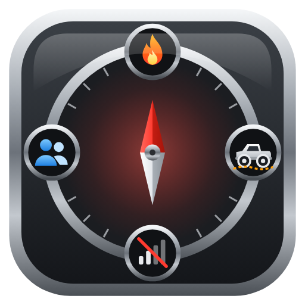

<p align="center">
  
</p>

<h1 align="center">AwareBC</h1>

<p align="center">
  <b>Every road. Every trail. Every alert.</b><br>
  A live safety map for British Columbia drivers and off-road riders, by Josh Singer.<br><br>
  <a href="https://sinkid420.github.io/Singer-Flight-Tracker/">Open the app</a> ·
  <a href="https://sinkid420.github.io/Singer-Flight-Tracker/support.html">Support</a> ·
  <a href="https://sinkid420.github.io/Singer-Flight-Tracker/privacy.html">Privacy &amp; Terms</a> ·
  <a href="https://github.com/SinKid420/Singer-Flight-Tracker/releases/tag/android-test">Android test app</a>
</p>

---

## What it is

AwareBC puts everything that matters on the road or the trail on one live map: closures and cameras, wildfires and evacuation alerts, weather, avalanche danger, ferries, planes overhead, and the riders you trust. It's built for BC, works on a phone first, and keeps working with no signal. No ads, no tracking, no selling data.

AwareBC is **not an emergency service**. In an emergency, call 911.

## Two modes

**On-road**: city, highways, cameras and ferries.
- DriveBC closures, incidents and highway cameras
- BC Ferries sailings and capacity, airports
- Directions with a driving mode and spoken turns

**Off-road**: FSRs, trails, Rig Link and a safety timer.
- Forest Service Roads, rec sites and trails, sled zones
- Avalanche forecasts and winter info
- **Rig Link**: see nearby riders (rounded to about 1 km), profiles, badges and top-down rigs in your own colour
- Trail reports, a safety timer, survival tools and the **Aware** tap-to-talk co-pilot

## Everywhere

- Live planes overhead (FlyItalyADSB · flyitalyadsb.com, CC BY-SA 4.0)
- Wildfires, evacuation orders, weather alerts, air quality, rain radar and space weather
- Alerts / Emergency hub with a safety score and nearest help
- Friends, groups and end-to-end locked chat, with SOS
- Saved offline maps and a Home card (ETA, sunset)
- Showroom: rigs posted by riders
- Automatic updates, anonymous crash reports, and a "Check data sources" screen

## Tech

- Plain JavaScript modules (no build step) on GitHub Pages, installable as a web app
- Android app built with Capacitor by GitHub Actions on every change
- Server: one Cloudflare Worker with a SQLite Durable Object (friends, Rig Link, reports, push, plane relay)
- Free data sources only

## Tests

```
bash tests/run.sh
```
Smoke and regression tests open the app at 360×640 (Samsung A32 size) with all outside data mocked. See [tests/README.md](tests/README.md).

## Roadmap

See [ROADMAP.md](ROADMAP.md) (🟢 done · 🟠 in progress · 🔴 to do).

## Contributing

Bug reports and ideas are welcome. See [CONTRIBUTING.md](CONTRIBUTING.md), the [Code of Conduct](CODE_OF_CONDUCT.md) and the [Security policy](SECURITY.md).

## License

© 2026 Josh Singer. All rights reserved. See [LICENSE](LICENSE) for details and third-party credits.
