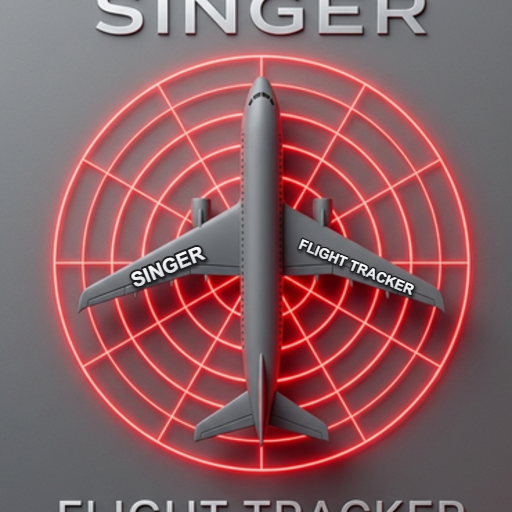

  

<h1 align="center">Singers Flight Tracker</h1>

  <b>See every plane overhead, live: where it's going, what it is, and what it's doing.</b> 
  <a href="https://sinkid420.github.io/Singer-Flight-Tracker/">Open the app</a> ·
  <a href="https://sinkid420.github.io/Singer-Flight-Tracker/privacy.html">Privacy policy</a>

---

## What it is

Singers Flight Tracker is a free, phone-first live flight tracker. Open it and every aircraft around you appears on the map, updated every few seconds. Tap a plane to see its route, arrival time and cockpit data, or hold your phone up to the sky and let AR label the planes you can see. No account, no ads, no tracking.

## Features

- **Live map** of the closest planes (30 by default, adjustable), coloured by altitude, with trails
- **Tap any plane** for airline, aircraft type, photo, departure and destination with the route drawn on the map, and an **arrival time estimate**
- **Cockpit tab**: flight phase, autopilot altitude and heading, autopilot modes, altimeter setting, vertical speed and squawk code
- **Aircraft tab**: registration, maker and model, registered owner, country and airline details
- **AR mode**: point your camera at the sky and planes are labelled where they are
- **Emergency alerts** when a plane nearby squawks 7700, 7600 or 7500
- **Around you now**: which airlines and aircraft types are flying near you
- **Animated weather radar** for Canada, the US and Mexico, plus local temperature
- **Map, Satellite and Terrain** views with Day, Night or Auto theme, and a compass with rotating map
- **Installable** on your phone's home screen (Google Play version coming)

## Data sources

Flight positions from [adsb.lol](https://adsb.lol) and FlyItalyADSB · routes and aircraft records from [adsbdb](https://www.adsbdb.com) · map © [OpenStreetMap](https://www.openstreetmap.org/copyright) contributors · radar from Environment and Climate Change Canada, NOAA/IEM and RainViewer · weather from Open-Meteo · photos from Planespotters.net
