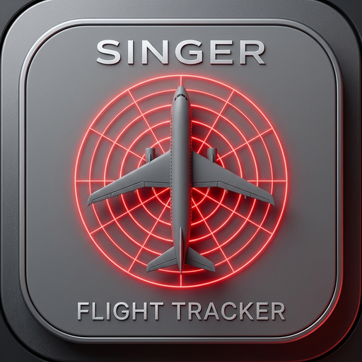

  

<h1 align="center">Singer Flight Tracker</h1>

  <b>Live planes overhead, with routes, radar and weather.</b> 
  <a href="https://sinkid420.github.io/Singer-Flight-Tracker/">Open the app</a> ·
  <a href="https://sinkid420.github.io/Singer-Flight-Tracker/privacy.html">Privacy policy</a>

---

## What it is

Singer Flight Tracker (shown in the app as **Sky Overhead**) is a free, mobile-first live flight tracker. Open it on your phone and see every plane flying around you on a map, updated every few seconds. No account, no ads, no tracking.

## Features

- **Live aircraft**: the closest 30 planes (adjustable), colour-coded by altitude, with trails showing where each has been
- **Tap a plane** to see its airline, aircraft type, altitude, speed, heading, distance from you, a photo, and its departure and destination, with the route drawn on the map
- **Animated weather radar** for Canada, the US and Mexico
- **Map, Satellite and Terrain** views, with Day, Night or Auto map theme
- **Compass** with a rotating map, plus the local temperature
- **Installable**: add it to your home screen and it runs like an app (Google Play version coming)

## Data sources

Flight positions from [adsb.lol](https://adsb.lol) and FlyItalyADSB · routes from [adsbdb](https://www.adsbdb.com) · map © [OpenStreetMap](https://www.openstreetmap.org/copyright) contributors · radar from Environment and Climate Change Canada, NOAA/IEM and RainViewer · weather from Open-Meteo · photos from Planespotters.net
